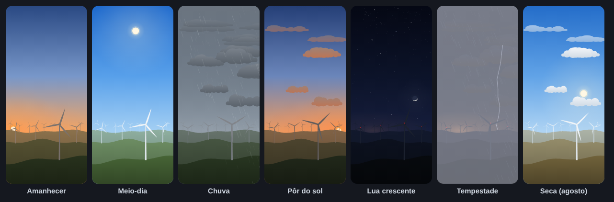

# Ventos de Palmas

Papel de parede animado para Android: torres eólicas no cerrado sob o céu de **Palmas-TO**.
A cena acompanha a hora, a posição real do Sol e da Lua e o clima atual da cidade.



## O que muda na cena

- **Hora e astros**: o Sol e a Lua são calculados no próprio celular para Palmas
  (−10,18°, −48,33°): nascer e pôr do sol, altura no céu, fase da Lua e o lado iluminado voltado
  para o Sol (perto do equador a lua crescente aparece "deitada").
- **Céu**: degradê que vai da noite ao dia passando por crepúsculo, aurora e pôr do sol, com brilho
  alaranjado no horizonte.
- **Noite**: estrelas que cintilam e giram devagar com o céu, Lua com luar e brilho da cidade no
  horizonte. As torres acendem as balizas vermelhas de aviação, piscando juntas como num parque eólico real.
- **Clima de Palmas** (Open-Meteo, a cada 20 minutos):
  - nuvens em quantidade proporcional à cobertura, levadas pelo vento;
  - céu acinzentado quando fecha o tempo;
  - chuva fraca, moderada ou forte, inclinada pelo vento;
  - relâmpagos nas trovoadas;
  - neblina.
- **Vento**: a velocidade do vento real define o giro das pás e a deriva das nuvens.
- **Estação**: o cerrado fica verde nas chuvas (nov–abr) e dourado na seca (jun–set).

Sem internet, a cena continua funcionando com céu limpo e brisa leve. Leituras de clima com mais
de 3 horas são ignoradas, para não mostrar uma chuva que já passou.

## Leve e vetorial

Tudo é desenhado com vetores: caminhos e degradês equivalentes a SVG, sem nenhuma imagem bitmap.
A cena escala para qualquer resolução, e o APK quase não tem recursos gráficos.

- Caminhos e degradês são montados uma vez e reaproveitados: **nenhuma alocação por quadro**.
- Desenho com o **Canvas acelerado por GPU** (`lockHardwareCanvas`).
- Sol, Lua e cores são recalculados a cada 30 s. Entre um cálculo e outro, cada quadro só move as
  pás, as nuvens, a chuva e o brilho das estrelas.
- Só desenha e só busca o clima **com o papel de parede visível**. Com a tela desligada ou um app
  aberto por cima, fica parado.

## Pensado para o Honor Magic7

Considerei o Magic7 e o Magic7 Pro: tela OLED LTPO de 120 Hz, cerca de 1264–1280 × 2800 px,
Snapdragon 8 Elite e MagicOS 9 (Android 15).

- **Taxa de quadros limitada**: 30 qps por padrão. As pás e a chuva ficam fluidas e o celular não
  desenha a 120 Hz à toa. No app dá para escolher 15 (economia) ou 60 (suave). Com a economia de
  bateria do sistema ligada, o papel de parede usa 15 qps.
- **OLED**: a noite é quase preta (pixels apagados gastam menos), e a base da paisagem é escura,
  o que também ajuda a ler os ícones.
- **Tela alta (≈ 20:9)**: a composição usa proporções da tela, e as prévias de teste são geradas
  em 1280 × 2800.
- Roda leve também em aparelhos mais simples, como o Magic7 Lite (minSdk 26 / Android 8).

## Como instalar e ativar

1. Baixe o artefato `ventos-de-palmas-apk` da última execução do workflow
   **Ventos de Palmas (Android)** no GitHub Actions. Descompacte e instale o `app-debug.apk`,
   permitindo a instalação de fontes desconhecidas.
2. Abra o app **Ventos de Palmas** e toque em **Definir como papel de parede**.
3. Na prévia do sistema, confirme. Alguns sistemas, como o MagicOS, podem aplicar papel de parede
   animado só na tela inicial.

O app também tem uma prévia ao vivo e um simulador de hora e clima (limpo, nuvens, nublado, chuva,
tempestade, neblina) para ver todas as variações sem esperar o tempo mudar.

## Como compilar

Requisitos: JDK 17 e Android SDK 35 (ou Android Studio).

```bash
cd VentosDePalmas
./gradlew testDebugUnitTest lintDebug assembleDebug
# APK: app/build/outputs/apk/debug/app-debug.apk
# Prévias da cena em SVG: app/build/previews/
```

Os testes desenham a cena em SVG em 14 horários e climas diferentes. No GitHub Actions essas
imagens ficam no artefato `previas-svg`.

## Estrutura

```
app/src/main/java/com/ragzonte/ventosdepalmas/
├── astro/      # posição do Sol e da Lua (Kotlin puro, testado contra o PyEphem)
├── weather/    # clima: códigos da OMM, cliente da Open-Meteo, climas para simulação
├── scene/      # a cena vetorial: cores (Look), desenho (WindScene) e a interface VectorCanvas
├── render/     # VectorCanvas sobre o Canvas do Android
├── data/       # cache do clima e preferências
├── wallpaper/  # WallpaperService (o papel de parede em si)
└── ui/         # tela do app com prévia e simulador (Jetpack Compose)
```

`astro`, `weather` e `scene` não dependem do Android. Por isso a mesma cena é desenhada em SVG
nos testes.

## Créditos

- Dados de clima: [Open-Meteo.com](https://open-meteo.com/), licença CC BY 4.0.
- Fórmulas astronômicas de baixa precisão de J. Meeus, *Astronomical Algorithms*.
